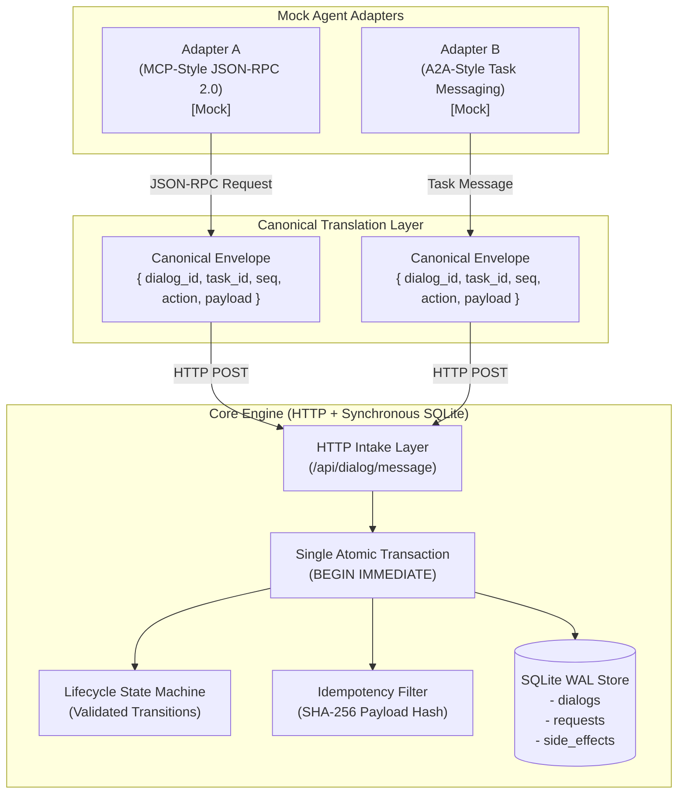
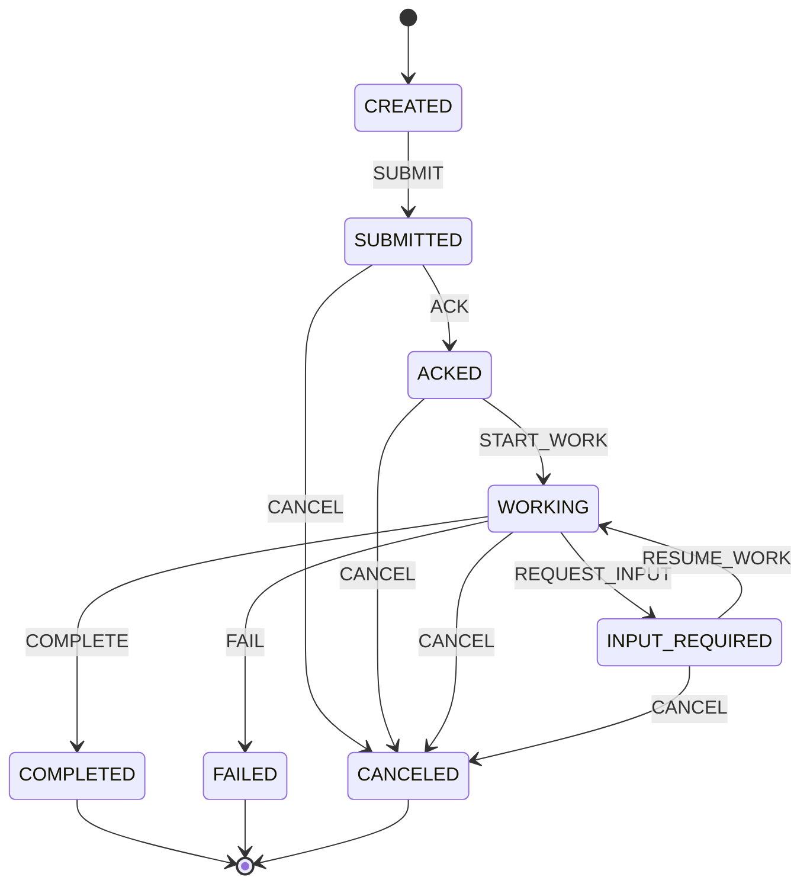

# AIORI-3 PS-021: Experimental Dialog Correlation and Recovery Across Agent Adapters

> **Schema Version**: `EXPERIMENTAL DRAFT v0, schema version pending mentor pinning`  
> **Delivery Model**: At-least-once transport delivery + idempotent receiver = effectively-once side effects within this prototype.

---

## 1. Overview & Architecture

This hackathon prototype implements cross-adapter dialog correlation and crash recovery for autonomous agent systems. It demonstrates how two heterogenous mock agent adapters—**Adapter A** (MCP-style JSON-RPC 2.0) and **Adapter B** (A2A-style task messages)—can exchange and coordinate long-running tasks through a shared, crash-resilient core engine.

### Architecture Diagram



---

## 2. SQLite Data Model

The prototype uses synchronous SQLite configured with **Write-Ahead Logging (WAL)** and **enforced Foreign Keys** (`PRAGMA foreign_keys = ON;`).

```sql
PRAGMA journal_mode = WAL;
PRAGMA foreign_keys = ON;

-- Core dialog state table correlating dialog_id with stable task_id across adapters
CREATE TABLE IF NOT EXISTS dialogs (
  dialog_id TEXT PRIMARY KEY,
  task_id TEXT UNIQUE NOT NULL,
  state TEXT NOT NULL,
  seq INTEGER NOT NULL DEFAULT 0,
  origin_adapter TEXT NOT NULL,
  schema_version TEXT NOT NULL,
  created_at TEXT NOT NULL,
  updated_at TEXT NOT NULL
);

-- Idempotency table tracking requests and cached responses to prevent duplicate execution
CREATE TABLE IF NOT EXISTS requests (
  dialog_id TEXT NOT NULL,
  request_id TEXT NOT NULL,
  payload_hash TEXT NOT NULL,
  response_json TEXT NOT NULL,
  attempts INTEGER DEFAULT 1,
  first_seen_at TEXT NOT NULL,
  PRIMARY KEY(dialog_id, request_id),
  FOREIGN KEY(dialog_id) REFERENCES dialogs(dialog_id)
);

-- Audit table tracking external side effects executed by the engine
CREATE TABLE IF NOT EXISTS side_effects (
  effect_id INTEGER PRIMARY KEY AUTOINCREMENT,
  dialog_id TEXT NOT NULL,
  request_id TEXT NOT NULL,
  effect_type TEXT NOT NULL,
  effect_data TEXT NOT NULL,
  created_at TEXT NOT NULL,
  UNIQUE(dialog_id, request_id, effect_type),
  FOREIGN KEY(dialog_id) REFERENCES dialogs(dialog_id)
);
```

### Canonical Envelope Interface

```typescript
export interface CanonicalEnvelope {
  schema_version: string;
  dialog_id: string;
  task_id: string;
  request_id: string;
  seq: number;
  action: "SUBMIT" | "ACK" | "START_WORK" | "REQUEST_INPUT" | "RESUME_WORK" | "COMPLETE" | "FAIL" | "CANCEL";
  payload: Record<string, unknown>;
  origin_adapter: "adapter-a-mcp" | "adapter-b-a2a";
}
```

---

## 3. State Machine Specification

Lifecycle states are strictly separated from transport events: network drops and timeouts are transport occurrences, not lifecycle states.



### Transition Table

| Current State | Target State | Permitted Action | Notes |
|---|---|---|---|
| `CREATED` | `SUBMITTED` | `SUBMIT` | Initial dialog submission |
| `SUBMITTED` | `ACKED` | `ACK` | Adapter acknowledges task |
| `SUBMITTED` | `CANCELED` | `CANCEL` | Early abort |
| `ACKED` | `WORKING` | `START_WORK` | Worker begins execution |
| `ACKED` | `CANCELED` | `CANCEL` | Abort before work |
| `WORKING` | `INPUT_REQUIRED`| `REQUEST_INPUT` | Agent pauses for user/tool input |
| `INPUT_REQUIRED`| `WORKING` | `RESUME_WORK` | Input provided, work resumed |
| `WORKING` | `COMPLETED` | `COMPLETE` | Successful completion (Terminal) |
| `WORKING` | `FAILED` | `FAIL` | Unrecoverable failure (Terminal) |
| `WORKING`, `INPUT_REQUIRED` | `CANCELED` | `CANCEL` | Terminal cancellation |
| `COMPLETED`, `FAILED`, `CANCELED` | *(none)* | *(none)* | **Terminal states**: all outgoing transitions rejected with `ILLEGAL_TRANSITION` |

---

## 4. How to Run

### Requirements
- Node.js (v22+ or v24 LTS recommended)
- Dependencies installed via `npm install`

### Run Automated Tests
Executes the comprehensive automated test suite asserting all 5 failure/recovery scenarios:
```bash
npm run test:scenarios
```

### Run Step-by-Step Interactive Demo
Runs all 5 scenarios with detailed terminal logs, step-by-step state progression, and prints the summary results table:
```bash
npm run demo
```

---

## 5. Scenario Results & Assertions

| Scenario | Objective | Status | Automated Assertions Verified |
|---|---|---|---|
| **Scenario 1** | Disconnect before ACK, then retry | **PASS** | Socket destroyed before engine records request. Client retries with identical `request_id`. Engine completes ACK. Asserted: exactly 1 `side_effects` row exists for `req-scen1-ack`, state is `ACKED`. |
| **Scenario 2** | Disconnect after commit before response, then retry | **PASS** | Engine commits `BEGIN IMMEDIATE` transaction to SQLite, then socket is dropped before HTTP response. Client retries with identical `request_id`. Engine detects duplicate via SHA-256 hash, returns stored response without running side effect. Asserted: exactly 1 side effect executed, `attempts = 2`, `is_duplicate = true`. |
| **Scenario 3** | Hard ungraceful crash mid-WORKING + Cross-Adapter Recovery | **PASS** | Adapter A (MCP) advances dialog to `WORKING`. Engine process is killed with `SIGKILL`. Engine process restarted against identical SQLite WAL database. Adapter B (A2A) continues using same `dialog_id` and stable `task_id` and completes flow. Asserted: `task_id` unchanged, state recovered as `WORKING`, final state `COMPLETED`. |
| **Scenario 4** | Same `request_id`, mutated payload | **PASS** | Request resent with identical `request_id` but modified payload. Engine flags hash mismatch and rejects with `REQUEST_ID_CONFLICT`. Asserted: error code `REQUEST_ID_CONFLICT`, 0 new side effects recorded. |
| **Scenario 5** | Late message after `COMPLETED` | **PASS** | Out-of-order message sent to an already `COMPLETED` dialog. Engine state machine rejects illegal transition on terminal state. Asserted: error code `ILLEGAL_TRANSITION`, state remains `COMPLETED`. |

---

## 6. Limitations and Non-Claims

To ensure complete technical honesty and academic rigor:
1. **No IETF Standard Compliance**: This project is an experimental prototype and does not conform to, or claim compliance with, any finalized or draft IETF RFC.
2. **Mock Adapters Only**: Adapter A (MCP-style) and Adapter B (A2A-style) are lightweight behavioral mocks simulating message framing patterns. Neither official MCP SDKs nor official A2A SDKs are utilized.
3. **No Distributed Interoperability Claims**: Full interoperability across external heterogeneous agent ecosystems is out of scope.
4. **Honest Delivery Model**: We do **not** claim physical "exactly-once delivery" over network transports, which is theoretically impossible in asynchronous networks. The true model is:
   $$\text{At-least-once transport delivery} + \text{Idempotent receiver} = \text{Effectively-once side effects within prototype}$$

link of explanation video: https://youtu.be/h6z4UesO1rs